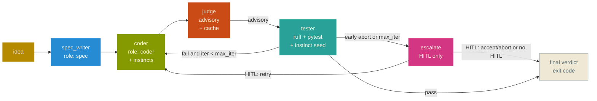
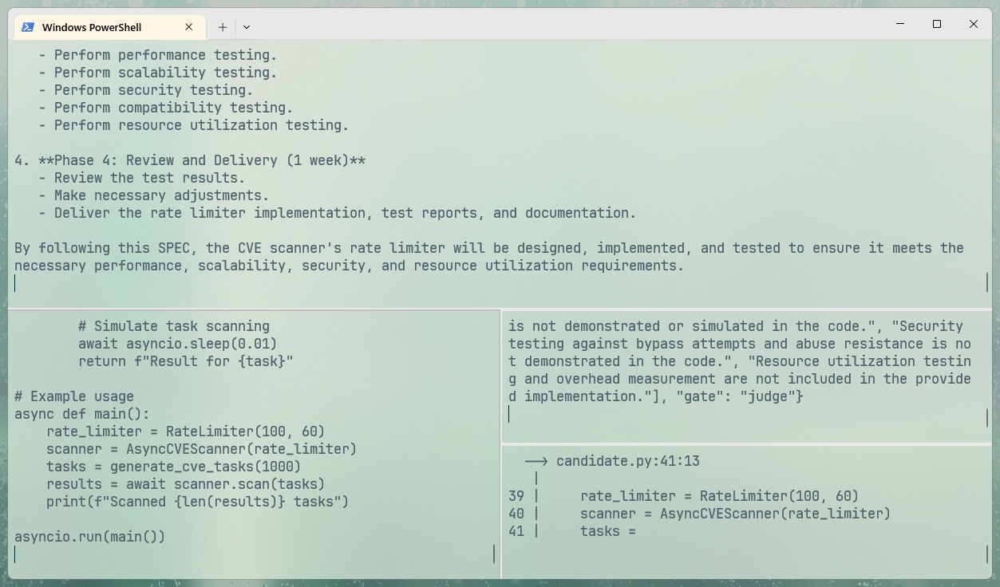

<div align="center">

# CiLydian

[](https://python.org)
[](https://langchain-ai.github.io/langgraph/)
[](https://github.com)
[](LICENSE)
[](https://pypi.org/project/cilydian/)
[](https://results.pre-commit.ci/latest/github/sleepti3ht/CiLydian/main)
</div>

> Self-hosted agentic CI pipeline on LangGraph: **spec → coder → LLM judge (advisory) → deterministic gates (ruff + pytest)**, with a bounded repair loop, self-learning instincts, and human escalation. Models are pluggable per role — local Ollama or any OpenAI-compatible endpoint.

---

## Why CiLydian?

Most multi-agent coding tools stop at "generate and hope." CiLydian treats LLM output as untrusted input: mechanical gates (ruff, pytest) are the source of truth, the LLM judge is advisory feedback, and the loop is bounded. If the pipeline can't converge in `MAX_ITER`, it exits with a status code and the full log — never hangs, never burns tokens indefinitely.

**Self-learning from failures.** When the coder gets stuck (early abort) or ruff catches missing imports (F821), the system records the lesson in an `instincts` table. Future runs inject these lessons into the coder prompt, reducing repeated mistakes.

**Eval-driven prompt engineering.** Cached verdicts export to promptfoo test suites with deterministic assertions — no grading tokens spent, corpus grows with every run.

Compared to AutoGen Studio or CrewAI: those are chat-orchestration frameworks. CiLydian is a **CI primitive** — it runs, exits with a status code, and can be wired into git hooks, GitHub Actions, or cron.

---

## Quick Start

```bash
# Install from PyPI
pip install cilydian

# Run with local Ollama (default)
cilydian run "Your task description"

# Or use the cloud profile
cp config.cloud.toml.example config.toml
cp .env.example .env  # fill with OpenRouter/Groq keys
cilydian run "Your task description"
```

Stack: `langgraph`, `langchain-ollama`, `langchain-openai`, `ruff`, `pytest`. See `requirements.txt`.

---

## Features

### Core
- **Spec-driven generation**: turn one-line ideas into a `SPEC.md` and a `test_candidate.py` skeleton before any code is written
- **Spec-first**: `--spec FILE` skips LLM spec generation for human-authored specs (source of truth)
- **Bounded repair loop**: coder iterates on judge feedback up to `MAX_ITER` times, then escalates to a human
- **Early abort**: detects when coder produces byte-identical code across iterations (hash comparison), exits early to save tokens
- **Advisory LLM judge**: semantic review that never blocks on its own verdict (see [Design notes](#design-notes))
- **Deterministic gates**: `ruff` (auto-fix + check) and `pytest`; these are what actually block the pipeline
- **Short-circuit**: pytest is skipped if ruff fails, saves 10–20s per failed cycle
- **Config-driven models**: mix Ollama local and OpenAI-compatible cloud per role
- **Rate-limit resilience**: exponential backoff for 429s on free tiers
- **UTF-8 on Windows**: subprocess encoding prevents `cp1251` mojibake in logs

### Self-learning
- **Instincts table**: SQLite-based lesson memory. Early abort and ruff F821 events seed lessons; top-N injected into coder prompt
- **Verdict cache**: SQLite-cached judge verdicts by hash (spec + code + model + temperature + prompt version), saves tokens on repeated code
- **Export-eval**: `python pipeline.py export-eval` dumps cached verdicts as promptfoo tests with deterministic Python assertions (no grading tokens)
- **Instincts CLI**: `python pipeline.py instincts show|add|clear` to inspect/manage learned lessons

### Human-in-the-loop
- **Interrupt points**: `interrupt()` on spec (continue/edit/reject) and escalation (accept/retry/abort) when HITL is enabled
- **Checkpoint persistence**: `SqliteSaver` checkpoints enable resume after Ctrl+C (via [cilydian-studio](#companion-cilydian-studio))
- **Studio client**: Textual TUI for interactive HITL sessions (separate package, see below)

### Reliability
- **Defensive JSON parsing**: judge verdicts normalized via `try: int(float(raw))`
- **Programmatic guardrail**: `score < 4` with `verdict="pass"` is auto-downgraded to `fail` (see [Design notes](#design-notes))
- **Markdown fence stripping**: handles LLM code wrapped in \`\`\` fences
- **Log rotation**: 5 MB cap with atomic `os.replace()`; single writer, no race
- **Isolated gates**: `runs/<run-id>/ruff.toml` and `pytest.ini` are auto-created on first run to prevent parent-config bleed
- **Preflight checks**: verifies `ruff` / `pytest` are on PATH and the coder endpoint is reachable before spending a single token

---

## Design notes

**The judge is advisory, the guardrails are not.** Local 7B–14B judges drift beyond SPEC — they request absent features, over- or under-rate code, and sometimes contradict themselves. So the LLM's verdict alone never blocks the pipeline. A separate programmatic rule handles one specific pathological case: if the LLM outputs `verdict="pass"` while scoring below 4, the guardrail downgrades it to `fail`. That's not the judge blocking — it's a deterministic check that doesn't trust a self-contradicting model. Mechanical gates (ruff, pytest) remain the ultimate source of truth.

**The repair loop is bounded on purpose.** `MAX_ITER` (default 3) caps attempts. Exhaustion means human escalation, not a hang. On complex tasks this may give up earlier than a human reviewer would prefer — acceptable for CI, where the cost of a false-negative is a re-run, not a lost afternoon.

**Mechanical fixes belong to the tool.** `ruff --fix` runs before `ruff check` and auto-corrects imports and formatting. LLM tokens are too expensive for style fixes a Rust binary does in 40 milliseconds.

**Self-learning is conservative.** Instincts are seeded only from deterministic signals (early abort, ruff F821), not from LLM opinions. Lessons are injected as "apply only if directly relevant" to avoid polluting unrelated tasks.

---

## Architecture



---

## Configuration

### Local Ollama profile (default)

```toml
# config.toml
[pipeline]
max_iter = 3
judge_blocking = false
hitl = false   # true = pause at spec and escalation points (requires cilydian-studio)
preflight_llm = true  # ping LLM endpoints before run

[roles.spec]
provider = "ollama"
model = "qwen2.5-coder:7b"
temperature = 0.0

[roles.coder]
provider = "ollama"
model = "qwen2.5-coder:7b"
temperature = 0.2

[roles.judge]
provider = "ollama"
model = "qwen2.5:14b"
temperature = 0.0
```

### Cloud hybrid profile (free tiers)

```toml
# config.cloud.toml.example
[pipeline]
max_iter = 3
judge_blocking = false
hitl = false

[roles.spec]
provider = "openai_compat"
base_url = "https://openrouter.ai/api/v1"
model = "deepseek/deepseek-chat"
api_key_env = "OPENROUTER_API_KEY"

[roles.coder]
provider = "openai_compat"
base_url = "https://openrouter.ai/api/v1"
model = "deepseek/deepseek-chat"
api_key_env = "OPENROUTER_API_KEY"

[roles.judge]
provider = "openai_compat"
base_url = "https://api.groq.com/openai/v1"
model = "openai/gpt-oss-120b"
api_key_env = "GROQ_API_KEY"
```

```bash
# .env
OPENROUTER_API_KEY=your_key_here
GROQ_API_KEY=your_key_here
```

> ⚠️ Never commit `.env` — keep secrets private. Config references env var names, not values.

---

## Eval-driven development

CiLydian caches judge verdicts in `memory.db` (SQLite, capped at 500 rows). Export them as promptfoo test suites:

```bash
# Generate corpus (YAML + Python assertion)
cilydian export-eval

# Run promptfoo eval
promptfoo eval -c promptfoo_eval.yaml --max-concurrency 2 ollama:chat:qwen2.5:14b
```

**What this measures:** agreement between current judge behavior and historical verdicts. A 50% pass rate means the judge disagrees with itself on half the cases — useful signal for prompt iteration or model swap.

**Instincts workflow:**

```bash
# Show learned lessons (top by hit count)
python pipeline.py instincts show
# [  3] f821:Callable       add `from typing import Callable`
# [  2] early-abort         when previous iteration produced identical code, add a # TODO

# Manually add a lesson
python pipeline.py instincts add "custom:imports|always start file with stdlib imports used in signatures"

# Clear all lessons
python pipeline.py instincts clear
```

---

## Companion: cilydian-studio

**cilydian-studio** is a Textual TUI client for human-in-the-loop sessions. Install from PyPI:

```bash
pip install cilydian-studio
```

**Usage:**

```bash
cilydian-studio "Your task description"
```

**Features:**
- Interrupt at spec (continue/edit/reject) and escalation (accept/retry/abort)
- Resume from checkpoint after Ctrl+C (SqliteSaver persistence)
- Live log streaming with rich formatting

**Source:** [github.com/sleepti3ht/cilydian-studio](https://github.com/sleepti3ht/cilydian-studio) | [PyPI](https://pypi.org/project/cilydian-studio/)

---

## Performance

| Metric | Local (7B coder) | Cloud (frontier) |
|---|---|---|
| Coder throughput | ~35 tok/s (RTX 3050) | ~50–100 tok/s |
| Judge throughput | ~3–6 tok/s (partial CPU offload) | ~30–60 tok/s |
| Full cycle wall time | 4–15 min | 1–3 min |
| Cache hit rate | ~60-80% on repeated code | ~60-80% on repeated code |
| Exit code | 0 = gates passed, 1 = failed | 0 = gates passed, 1 = failed |

**Typical run:**

```log
[preflight] ruff: OK
[preflight] pytest: OK
[preflight] coder endpoint: reachable
[spec] Generated SPEC.md + test_candidate.py (1.2s)
[coder] Iteration 1/3 — wrote candidate.py (3.4s)
[judge] score=3, verdict=fail (advisory)
[tester] ruff rc=0, pytest rc=1 (fail)
[coder] Iteration 2/3 — fixed issues (2.8s)
[judge] cache hit key=a3f2e1b0 score=4 verdict=pass (advisory)
[tester] ruff rc=0, pytest rc=0 (pass)
✓ Pipeline completed: gates passed (exit code 0)
```

---

## Honest Limitations

- **Local models (7b-14b) fail convergence** on mid-complexity tasks (e.g., sliding-window rate limiter with exact boolean return) within 3 iterations.
- **Cloud free-tier models (Groq gpt-oss-120b)** provide better judge quality but have rate limits (200K tokens/day).
- **CiLydian is an exploration of agentic workflows** — a project driven by curiosity about graph orchestration, state machines, and the boundaries of local LLMs in CI, rather than a daily-driver replacement for human developers. For high-stakes production, pair it with manual multi-vendor workflows (DeepSeek for prompting, Claude for architecture, local ruff/pytest for gates).

---

## Screenshot



---

## Roadmap

- [x] **Self-learning instincts** — early abort and F821 lessons injected into coder prompt (v0.3.0)
- [x] **Export-eval** — verdict memory → promptfoo corpus with deterministic assertions (v0.3.0)
- [x] **Human-in-the-loop** — interrupt points on spec and escalation via cilydian-studio (v0.3.0)
- [ ] **GitHub Actions integration** — trigger CiLydian on issue labels or PR comments
- [ ] **Multi-language support** — extend beyond Python (JavaScript, Go)
- [ ] **Web dashboard** — visualize pipeline runs, logs, and instinct growth
- [ ] **Plugin system** — custom gates beyond ruff/pytest (mypy, bandit, murmur)
- [ ] **Living specs** — append run summary (verdict, iterations, key issues) to SPEC.md

---

## Contributing

Contributions are welcome! Please open an issue or submit a PR.

### Development setup

```bash
git clone https://github.com/sleepti3ht/CiLydian.git
cd CiLydian

# Unix / macOS
python -m venv .venv && source .venv/bin/activate
# Windows (PowerShell)
python -m venv .venv; .\.venv\Scripts\Activate.ps1

pip install -r requirements.txt
pip install pre-commit
pre-commit install  # enforces ruff + pytest on commit

# Run the pipeline on a sample task
python pipeline.py "Test task"

# Inspect learned lessons
python pipeline.py instincts show
```

### Code style

- Commit messages: Conventional Commits (`feat(pipeline): ...`, `fix(tester): ...`)
- Run `ruff check` and `pytest` before pushing (enforced by pre-commit)

---

## License

MIT
